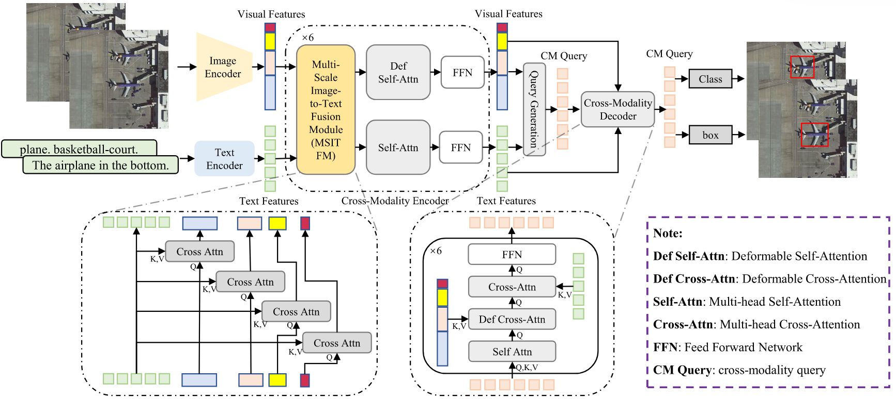

[TGRS 2025] Efficient Grounding DINO
===
Here is the code implementation of our lab's paper [**TGRS 2025**:*Efficient Grounding DINO: Efficient Cross-Modality Fusion and Efficient Label Assignment for Visual Grounding in Remote Sensing*](https://ieeexplore.ieee.org/abstract/document/10857369). 



# Codes
## 0. Explains
Since the senior has graduated, our personal skills and energy are limited, so we have arranged a rough version for your reference. we will rearrange it after we finish our study of mmdetection.

PS:To avoid safe problem, we replace real work dir with `"WORK_DIR"` of dataset root and configs! Use `"senior"` replace real username!

# Codes
## 1. Prepare Language_model
You should download bert-base-uncased to `./language_models`, structure like `bert-base-uncased_tree.log`.

## 2. Datasets
You can put the individual data sets in `./detection_data` and the data organization directory tree reference file './detection_data/datasets.txt'

## 3. Environments
Thanks to the work of mmdetection, the code is developed based on mmdetection.

Ours Environment is Python 3.8.18, CUDA 11.7
```bash
### create env
conda create -n mmdet-38 python=3.8.18 -y
conda activate mmdet-38

### Install important packages
pip install torch==1.13.0+cu117 torchvision==0.14.0+cu117 torchaudio==0.13.0 --extra-index-url https://download.pytorch.org/whl/cu117

pip install openmim==0.3.9
mim install mmengine==0.9.0
mim install mmcv==2.1.0

### Install mmdet
# NOTE: If you has problem with using mmdetection, consider to clone the mmdetection repo and install it before copy ours models files.
# git clone https://github.com/open-mmlab/mmdetection.git
cd WORK_DIR/mmdetection
pip install -v -e .

### Install others
# cd WORK_DIR
pip install -r py38-requirements.txt
```

## 4. Models
You can run our experiments by `./mmdetection/tools/*.sh` and `./mmdetection/configs/grounding_dino/*.py`

Example:

```bash
cd WORK_DIR/mmdetection

# Efficient Grounding DINO for RSVG
CUDA_VISIBLE_DEVICES={GPU_ID_list}  ./tools/dist_train.sh ./configs/grounding_dino/grounding_dino_fusion_decouple_IoU_match_r50_scratch_8xb2_1x_RSVG.py {NUM_GPU}

# Efficient Grounding DINO (with data augmentation) for RSVG
CUDA_VISIBLE_DEVICES={GPU_ID_list}  ./tools/dist_train.sh ./configs/grounding_dino/grounding_dino_augment_fusion_decouple_IoU_match_r50_scratch_8xb2_1x_RSVG.py {NUM_GPU}

# Efficient Grounding DINO for RSVG_HR
CUDA_VISIBLE_DEVICES={GPU_ID_list}  ./tools/dist_train.sh ./configs/grounding_dino/grounding_dino_fusion_decouple_IoU_match_r50_scratch_8xb2_1x_RSVG_HR.py {NUM_GPU}

# Efficient Grounding DINO (with data augmentation) for RSVG_HR
CUDA_VISIBLE_DEVICES={GPU_ID_list}  ./tools/dist_train.sh ./configs/grounding_dino/grounding_dino_augment_fusion_decouple_IoU_match_r50_scratch_8xb2_1x_RSVG_HR.py {NUM_GPU}

# Efficient Grounding DINO (with data augmentation)(Finetune) for RSVG_HR
CUDA_VISIBLE_DEVICES={GPU_ID_list}  ./tools/dist_train.sh ./configs/grounding_dino/grounding_dino_augment_finetune_fusion_decouple_IoU_match_r50_scratch_8xb2_1x_RSVG_HR.py {NUM_GPU}
```

## 5. Finally
We have arranged a rough version for your reference. We will reschedule when we finish the study of mmdetection.

# Citing
If you find our work useful in your research, please consider citing:
```
@ARTICLE{10857369,
  author={Hu, Zibo and Gao, Kun and Zhang, Xiaodian and Yang, Zhijia and Cai, Mingfeng and Zhu, Zhenyu and Li, Wei},
  journal={IEEE Transactions on Geoscience and Remote Sensing}, 
  title={Efficient Grounding DINO: Efficient Cross-Modality Fusion and Efficient Label Assignment for Visual Grounding in Remote Sensing}, 
  year={2025},
  volume={63},
  number={},
  pages={1-14},
  keywords={Visualization;Grounding;Remote sensing;Object detection;Feature extraction;Training;Decoding;Contrastive learning;Natural languages;Convergence;Cross-modality fusion module;misassignment;multi-scale image-to-text fusion module (MSITFM);text confidence matching (TCM);visual grounding for remote sensing (RSVG)},
  doi={10.1109/TGRS.2025.3536015}}
```